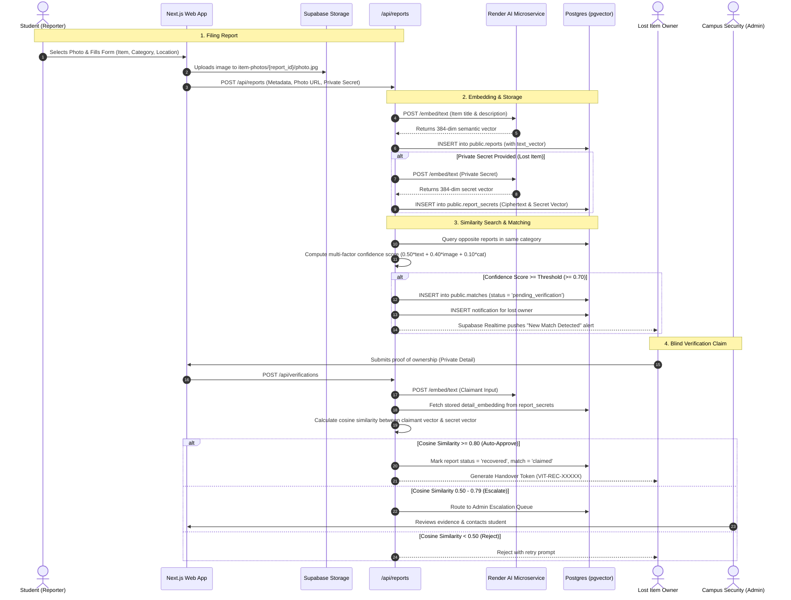

# System Architecture & Pipeline Workflow
## VIT Lost & Found Platform

---

## 1. High-Level Architectural Topology

```mermaid
flowchart TD
    subgraph Client Tier
        Browser["Student / Staff Web Browser\n(Responsive Desktop & Mobile)"]
    end

    subgraph Hosting Tier (Vercel)
        NextApp["Next.js 14 App Router (SSR & Static Assets)\nhttps://vit-lost-and-found-roan.vercel.app"]
        APIRoutes["Next.js Route Handlers (/api/*)\nEdge Middleware Auth Guards"]
    end

    subgraph Cloud Infrastructure (Supabase)
        Postgres["PostgreSQL 15 Managed Database\n(pgvector + pgcrypto + RLS)"]
        Storage["Supabase Object Storage\n('item-photos' Bucket)"]
        Realtime["Supabase Realtime Engine\n(WebSocket Broadcasts & Changes)"]
    end

    subgraph AI Microservice Tier (Render)
        FastAPI["FastAPI Python Microservice\n(all-MiniLM-L6-v2 + CLIP ViT-B/32)"]
    end

    Browser <-->|HTTPS & WebSockets| NextApp
    NextApp <--> APIRoutes
    APIRoutes <-->|TLS REST & RPC| Postgres
    APIRoutes <-->|Signed URLs & S3| Storage
    APIRoutes <-->|HTTP /embed| FastAPI
    Browser <-->|WSS Live Events| Realtime
    Postgres -.->|pg_notify triggers| Realtime
```

---

## 2. Core Architectural Components

### 2.1 Frontend & Application Layer
- **Framework**: Next.js 14 (App Router) with React 18 and TypeScript.
- **Hosting**: Vercel Serverless Platform (`https://vit-lost-and-found-roan.vercel.app`).
- **Styling & Components**: Tailwind CSS with custom `@vit/ui` shared component library (cards, inputs, badges, step indicators, loading states). Supports light and dark mode with persistent user preferences.
- **Route Protection**: Next.js Edge Middleware (`apps/web/src/middleware.ts`) evaluating cryptographically authenticated sessions before rendering protected student (`/dashboard`, `/report/*`, `/matches`, `/profile`) and admin (`/admin/*`) pages.

### 2.2 Backend & Data Persistence Layer
- **Database Engine**: PostgreSQL 15+ hosted on Supabase (`db.ruvkhuocnixoouphosku.supabase.co`).
- **Access Control**: Strict PostgreSQL **Row Level Security (RLS)** active on all 11 tables.
- **Logical Segregation**: Single core `reports` table powering pgvector comparisons, presented through two separate security-invoking views (`lost_items` and `found_items`).
- **File Storage**: Supabase Storage private bucket `item-photos` organizing uploaded items in structured paths: `item-photos/{report_id}/photo.{ext}`.
- **Real-Time Notification Channel**: Supabase Realtime broadcast channels (`vit_live_events`, `dashboard_realtime_events`) pushing instant alerts to active user browser sessions upon new match detection.

### 2.3 AI Embedding & Similarity Microservice
- **Framework**: Python 3.11 with FastAPI.
- **Hosting**: Containerized on Render (`https://vit-lost-found-embeddings.onrender.com`).
- **Text Embedding Model**: `sentence-transformers/all-MiniLM-L6-v2` generating 384-dimensional dense vectors for semantic text comparison.
- **Image Feature Extraction**: OpenAI `CLIP ViT-B/32` generating 512-dimensional embeddings for visual item comparison.
- **Reliability Policy**: Protected by Bearer authentication. When the service is offline or cold-starting, verification claims automatically route directly to the **Campus Security Escalation Queue** without silent degradation or weak text approximations.

---

## 3. End-to-End Report & Match Lifecycle


