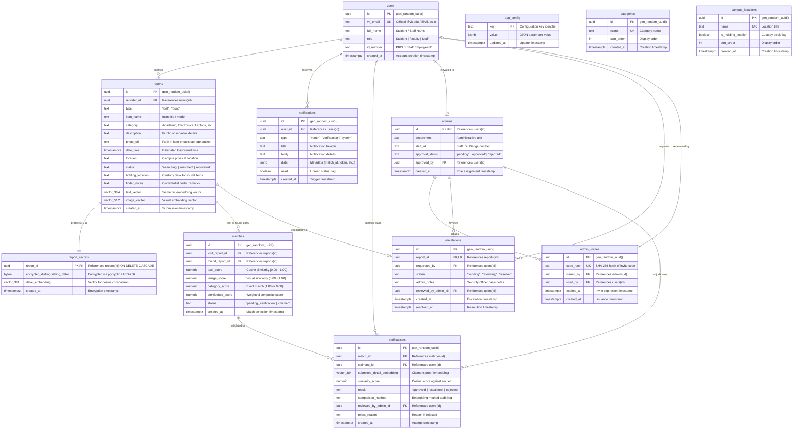

# Entity-Relationship Diagram (ERD)
## VIT Lost & Found Campus Platform

The following diagram represents the production database schema deployed in **Supabase PostgreSQL 15+** with `pgvector` and `pgcrypto` extensions.

---

### Database Views

1. **`public.lost_items`**: Read-only view filtering `reports WHERE type = 'lost'` with `WITH (security_invoker = true)` to apply caller Row Level Security.
2. **`public.found_items`**: Read-only view filtering `reports WHERE type = 'found'` with `WITH (security_invoker = true)`.
